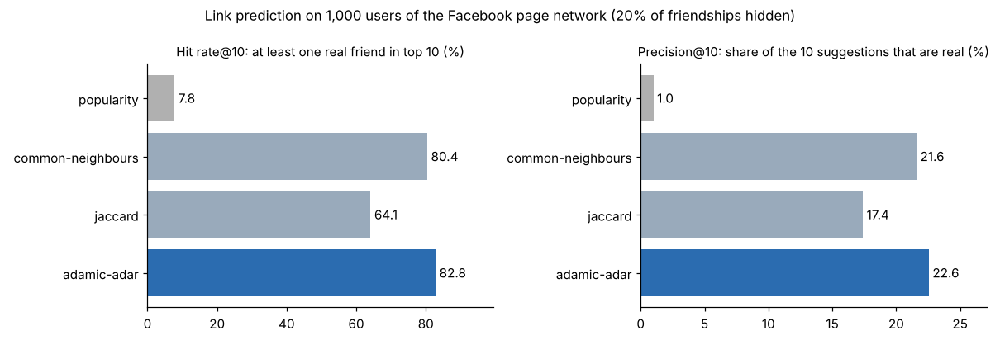

# Friend Recommendation using Graph Data Structures (C)

A fast friend-recommendation engine in plain C11. Users are vertices and friendships are edges. The engine suggests "people you may know" with three classic link-prediction scores, finds degrees of separation with BFS, and runs on a real **22,470-user, 170,823-friendship** network. In testing, **83% of users got at least one real friend in their top 10**, and each query took **0.15 ms**.



## What changed from the first version

The original was a 300-line menu program written for a data-structures course. This version keeps the same menu, but the engine underneath is new:

| | v1 (coursework) | v2 (this) |
|---|---|---|
| Capacity | 100 users, 100 friends each (fixed arrays) | Unlimited, with dynamic arrays and a hash map from id to user |
| "Are A and B friends?" | Linear scan | Binary search on sorted adjacency, O(log d) |
| Recommendations | Printed every friend-of-friend, **with duplicates**, unranked | Ranked top-K by Common Neighbours, Jaccard or Adamic-Adar, no duplicates |
| Self-friendship | Allowed (bug) | Blocked |
| Input | `scanf("%s")` could overflow the 50-byte name buffer | Bounded `fgets`, survives non-numeric input |
| New features | – | Degrees of separation (BFS shortest path), network statistics, load CSV/CSV.gz edge lists, save and reload |
| Proof it works | – | Unit tests under AddressSanitizer + UBSan, link-prediction evaluation on real data, CI |
| Makefile | Mentioned in the README, but missing | `make`, `make test`, `make eval` |

The original file is kept as `legacy_friend_recomendation.c` for comparison.

## How recommendation works

For user **u**, the engine walks u's friends and *their* friends once, counting for each stranger **v** how they are connected:

| Score | Formula | Intuition |
|---|---|---|
| Common Neighbours | \|N(u) ∩ N(v)\| | More mutual friends = more likely to know each other |
| Jaccard | \|N(u) ∩ N(v)\| / \|N(u) ∪ N(v)\| | Mutual friends, adjusted for how many friends each person has |
| **Adamic-Adar** | Σ over mutual friends w of 1 / log(deg w) | A mutual friend with few friends is stronger evidence than a celebrity everyone follows |
| Popularity (baseline) | deg(v) | "Suggest the most popular people", which is what you'd do without the graph |

Existing friends and the user themselves are excluded. The top K are kept in a small sorted buffer, so the cost is O(Σ deg(friends) + candidates · log d).

## Evaluation: does it predict real friendships?

The test uses link prediction on the [Facebook page–page network](https://github.com/benedekrozemberczki/MUSAE) (MUSAE, Rozemberczki et al. 2019). It has 22,470 verified Facebook pages, with an edge wherever two pages mutually like each other.

1. Pick 1,000 random users with 10 or more friends (seeded, reproducible).
2. Hide 20% of each one's friendships.
3. Ask each method for 10 suggestions. A hit is a suggestion that is one of the hidden friends.

| Method | Hit rate@10 | Precision@10 | Recall@10 | ms / query |
|---|---|---|---|---|
| Popularity (baseline) | 7.8% | 1.0% | 1.2% | 1.35 |
| Jaccard | 64.1% | 17.4% | 31.1% | 0.16 |
| Common Neighbours | 80.4% | 21.6% | 42.3% | 0.23 |
| **Adamic-Adar** | **82.8%** | **22.6%** | **44.4%** | **0.15** |

**Findings:** using the graph's structure is about 23× more precise than suggesting popular users. Adamic-Adar wins because it discounts mutual connections through hubs. Jaccard over-rewards users with very few friends. The whole 22k-user graph loads in 0.16 s.

## Build and run

```bash
make                 # builds ./friendrec and ./evaluate (gcc or clang, no dependencies)
make test            # 27 checks under AddressSanitizer + UndefinedBehaviorSanitizer
make eval            # reproduces results/evaluation.json (~2 s)

./friendrec data/demo_network.txt          # interactive menu, small demo network
./friendrec                                # empty network; menu option 10 loads data/facebook_pages_edges.csv.gz
```

Example session (`results/demo_session.txt`):

```
Top suggestions for Abhinav (user 6) by adamic-adar:
  #    User ID    Name                 Mutual   Score
  1    3          Rahul                2        1.632
  2    4          Soham                2        1.632
  3    1          Shubhan              1        0.721
5 degree(s) of separation: Abhinav -> Saif -> Shubhan -> Atharva -> Ishaan -> Namita
Users: 10   Friendships: 15   Average friends: 3.00   Max friends: 4
```

## Menu

1 add user · 2 add friendship · 3 remove friendship · 4 recommend (choose the method) · 5 list users · 6 show friends · 7 display the adjacency list · 8 degrees of separation · 9 network statistics · 10 load an edge list (CSV or .csv.gz) · 11 save · 0 exit

## Structure

```
src/graph.h, graph.c   graph library: users, sorted adjacency, hash map, recommenders, BFS, components, I/O
src/main.c             interactive menu
src/evaluate.c         link-prediction benchmark
tests/test_graph.c     unit tests (run under sanitizers)
data/                  facebook_pages_edges.csv.gz (real network), demo_network.txt
results/               evaluation.json, demo_session.txt
.github/workflows/     CI: build, test, quick evaluation on every push
```

## Future work

- Weight suggestions by shared interests and groups (an attributed graph)
- Personalised PageRank / random-walk recommenders for 3+ hop suggestions
- An HTTP API wrapper so a web front end can call the C engine
